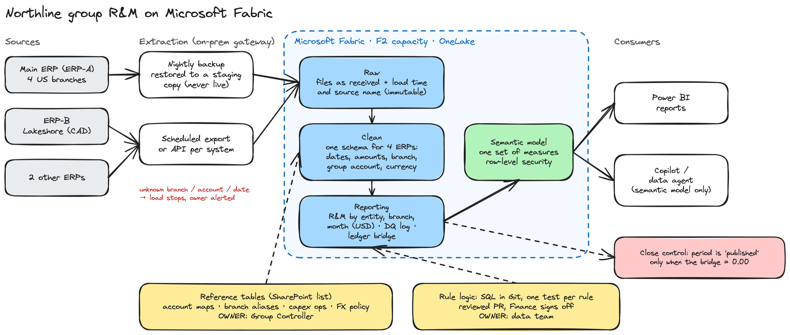
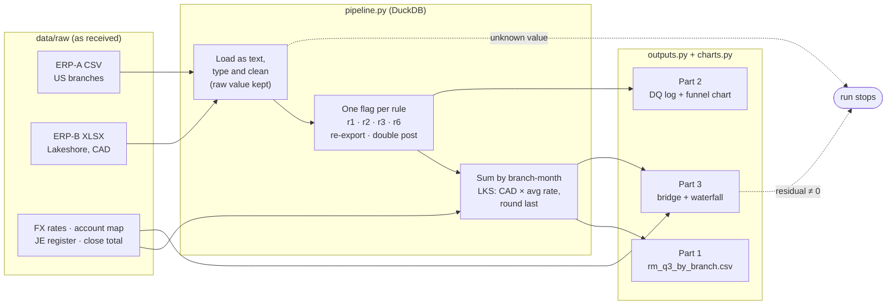

# Northline Q3 2026 R&M — KT Grant take-home

This repo turns the raw ERP-A and ERP-B files into Q3 2026 repair and maintenance (R&M) cost by branch and month, logs every data issue, and bridges the result to Accounting's figure to the cent.

| | USD |
|---|---|
| **Finance Q3 R&M** (`output/rm_q3_by_branch.csv`) | **14,154,722.25** |
| + JE-1026: gearbox overhaul accrual, posted by Accounting after the last ERP export | 21,375.00 |
| + Lakeshore September translated at the month-end rate instead of the average | 10,554.78 |
| **= Accounting reported** | **14,186,652.03** |
| Residual | **0.00** |

## Run it

Requires Python 3.10+.

```bash
make all        # create .venv, install requirements, build all outputs, run the tests
make run        # rebuild outputs only
make test       # 14 tests: one per README rule, format, the bridge, and the bridge after a config change
```

The raw files in `data/raw/` are the data pack exactly as received. Every output is regenerated from them, and two clean runs produce byte-identical files.

## Deliverables

| Part | File |
|---|---|
| 1. Q3 R&M by branch and month (required format) | [`output/rm_q3_by_branch.csv`](output/rm_q3_by_branch.csv) |
| 2. Data quality log | [`docs/02_data_quality_log.md`](docs/02_data_quality_log.md) (source: `output/dq_log.csv`) |
| 3. Reconciliation to Accounting | [`docs/03_reconciliation.md`](docs/03_reconciliation.md) (source: `output/reconciliation.csv`) |
| 4. Design memo (one page) | [`docs/04_design_memo.md`](docs/04_design_memo.md) / [PDF](docs/04_design_memo.pdf); architecture diagram below ([source](docs/architecture.excalidraw), editable at excalidraw.com) |
| 5. How I used AI | [`docs/05_ai_log.md`](docs/05_ai_log.md) |

## Target architecture (Part 4)



## How the code is organised




| File | What it does |
|---|---|
| `src/rm/rules_config.py` | The 8 README rules as parameters (accounts, capex operations, period, Elmwood date, FX rate column, 73xx-RM pattern, branch aliases). Changing a rule is a one-line edit. |
| `src/rm/pipeline.py` | Loads every file as text, then types and cleans it, keeping the raw value next to the clean one. Adds one flag per rule to each line (`r1_rm_account`, `r2_capex`, `r3_in_q3`, `report_branch`, `r6_rm_account`) and builds R&M by branch and month in DuckDB. |
| `src/rm/outputs.py` | Writes the Part 1 CSV, the DQ log and the reconciliation. Every amount is computed from the data, never typed in. |
| `src/rm/charts.py` | Draws the DQ funnel and the bridge waterfall from the same tables, so the charts follow any rule change. |
| `tests/test_rules.py` | One test per README rule, plus re-export dedup, double-post flag, Lakeshore subtotals, output format and the bridge closing. |

**Fail loudly:** an unknown branch spelling, an unparsable date or amount, a subtotal that does not match its detail, a month without an FX rate, or a bridge that does not close all stop the run. Nothing is dropped silently.

## Decisions and assumptions

1. **Duplicate export.** The 24-Aug export repeats all 780 lines of the 22-Aug export. One copy is kept per (SRO, Line), the one from the latest export. The run checks that the copies agree after cleaning, and they all do.
2. **Slash dates are MM/DD.** This is proven, not assumed: all 582 fall 0–9 days before their export, the same lag as the ISO dates.
3. **Reversals count in the month of their own date** (rule 3), never netted against the original line. Eight cross a month boundary, all inside Q3.
4. **Lakeshore** is translated by summing each month's CAD at full precision, multiplying by that month's average rate, and then rounding to cents (rules 5 and 8).
5. **7345-RM-WELD** is not in Accounting's account map. It is included because rule 6 says every 73xx-RM account is R&M.
6. **Suspected double posts (not covered by the README).** 25 lines in the same export are identical to another line on SRO, operation, date, account, item, quantity and unit cost; only the Line number differs. 24 of them are in R&M scope (52,127.78 USD). **They are kept and flagged**, because Accounting's ledger total includes them: the bridge closes only with them in. To exclude them, set `DROP_SUSPECTED_DOUBLE_POSTS = True` in `rules_config.py`. The bridge then gains a third item and still closes.
7. **Manual journal entries** are not an input (rule 7). The reconciliation lists every JE: JE-1026 is a reconciling item, and the others are shown at 0.00 with the reason (non-R&M account, or posted after 30-Sep).

## Data

The data pack is fictional, as stated in the brief. `docs/brief.pdf` is the exercise brief as received.
